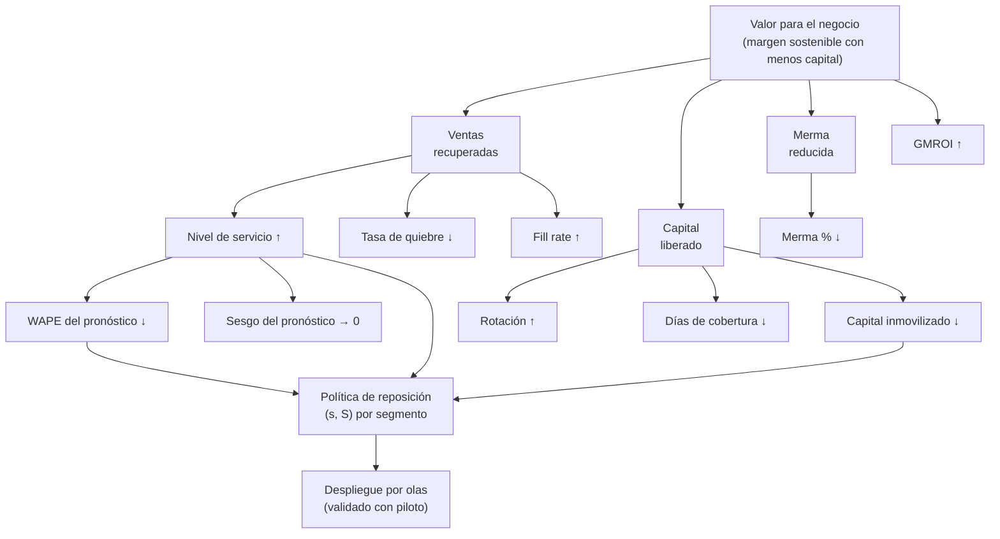

# 01. Marco del proyecto

## Acta de proyecto

| Campo | Detalle |
|---|---|
| **Nombre** | Optimización de inventario y pronóstico de demanda — Supermercados Horizonte Sur |
| **Patrocinador** | Dirección de Operaciones y Dirección Comercial |
| **Líder de negocio** | Gerencia de Cadena y Abastecimiento |
| **Analista responsable** | Franco Tilleria Centurión (Business Analyst / Analista Funcional) |
| **Periodo de análisis** | 01/01/2024 al 31/12/2025 (datos sintéticos) |
| **Alcance** | 12 sucursales, ~400 SKU, 36 proveedores, canal presencial |
| **Duración estimada** | 16 semanas (8 fases de análisis + 8 de despliegue por olas) |
| **Inversión estimada** | Ver hoja de supuestos del caso de negocio (documento 08) |

### Situación problemática

La cadena enfrenta simultáneamente dos problemas que compiten por el mismo capital:

1. **Quiebres de stock** en los productos de mayor venta (~9% de los días-serie en productos A),
   que generan ventas perdidas no medidas hoy.
2. **Capital inmovilizado** en productos de baja rotación (~22% del inventario valorizado),
   además de merma relevante en perecederos por vencimiento.

### Objetivo general

Diseñar y evaluar una política de reposición basada en pronóstico de demanda que reduzca
las ventas perdidas por quiebre sin aumentar el capital inmovilizado ni la merma,
cuantificando el impacto financiero y validando la mejora con un piloto controlado.

### Objetivos específicos

1. Medir dónde se pierde más dinero: ventas perdidas por quiebre, sobre-stock y merma.
2. Cuantificar la mejora del pronóstico de demanda frente al método actual (media móvil de 4 semanas).
3. Determinar la política de reposición que minimiza el costo total (holding + orden + quiebre + merma).
4. Estimar el impacto financiero (VAN, TIR, periodo de recuperación) del despliegue completo.
5. Definir el diseño estadístico de un piloto que permita decidir el escalamiento con evidencia.

### Fuera de alcance

- Precios, surtido y planogramas (se consideran dados).
- Logística de última milla y e-commerce.
- Negociación con proveedores (se modela el lead time observado, no su renegociación).

## Mapa de interesados

| Interesado | Rol | Interés principal | Influencia | Estrategia |
|---|---|---|---|---|
| Dirección General | Aprueba inversión | VAN, riesgo de ejecución | Alta | Resumen ejecutivo mensual |
| Dirección Comercial | Dueña del margen | Ventas perdidas, disponibilidad | Alta | Tablero semanal de quiebres |
| Gerencia de Cadena | Operará la política | Herramienta simple, confiable | Alta | Piloto y capacitación |
| Jefes de sucursal | Ejecutan reposición | Carga operativa, autonomía | Media | Manual de reposición sugerida |
| Finanzas | Controla capital de trabajo | Capital inmovilizado, merma | Alta | Caso de negocio y seguimiento |
| TI / Datos | Integra sistemas | Requisitos no funcionales, esfuerzo | Media | Historias técnicas y RACI |
| Proveedores clave | Entregan mercadería | Previsibilidad de pedidos | Media | Plan de comunicación por olas |
| Clientes | Compran | Disponibilidad del producto | Baja (indirecta) | NPS como señal de resultado |

## Árbol de KPIs

## Catálogo de KPIs

Definiciones formales que el pipeline implementa. `sucursal`, `sku`, `fecha` son las
granularidades; la fuente indica la tabla del modelo en estrella.

| KPI | Definición / fórmula | Fuente | Granularidad | Responsable |
|---|---|---|---|---|
| **Nivel de servicio (ciclo)** | Proporción de ciclos de reposición sin quiebre: `1 − ciclos_con_quiebre / ciclos_totales` | `hechos_inventario`, `hechos_ventas` | sucursal × sku × mes | Gerencia de Cadena |
| **Tasa de quiebre** | Días con `stock_disponible = 0` sobre días con demanda potencial > 0 | `hechos_ventas` (censurada) | sucursal × sku × mes | Gerencia de Cadena |
| **Fill rate (unidades)** | `venta_observada / demanda_estimada` en días con quiebre imputados; contra verdad sintética: `venta / demanda_real` | `hechos_ventas` / `verdad_oculta` | sucursal × sku × mes | Dirección Comercial |
| **Rotación** | `costo_de_ventas_anual / inventario_promedio_valorizado` | `hechos_ventas`, `hechos_inventario` | sku (cadena) | Finanzas |
| **Días de cobertura** | `inventario_promedio_valorizado / costo_de_ventas_diario` | `hechos_inventario`, `hechos_ventas` | sucursal × sku | Gerencia de Cadena |
| **Capital inmovilizado** | Valor del inventario con cobertura > umbral de política (SKU C o XYZ-Z) al cierre | `hechos_inventario` | sucursal × categoría | Finanzas |
| **Merma %** | `merma_valorizada / (ventas_valorizadas + merma_valorizada)` | `hechos_inventario` | sucursal × categoría × mes | Operaciones |
| **GMROI** | `margen_bruto_anual / inventario_promedio_a_costo` | `hechos_ventas`, `hechos_inventario` | categoría (cadena) | Dirección Comercial |
| **WAPE** | `Σ|demanda_real − pronóstico| / Σ demanda_real` | backtesting (documento 05) | segmento ABC-XYZ | Analítica |
| **Sesgo del pronóstico** | `Σ(pronóstico − demanda_real) / Σ demanda_real` | backtesting (documento 05) | segmento ABC-XYZ | Analítica |
| **MASE** | `MAE del modelo / MAE del naive estacional` sobre el mismo origen | backtesting (documento 05) | segmento ABC-XYZ | Analítica |

### Definiciones de segmentos

- **ABC (valor):** clasificación por contribución acumulada al margen: A hasta 80%, B hasta 95%, C el resto.
- **XYZ (variabilidad):** X si `CV ≤ 0.5`, Y si `0.5 < CV ≤ 1.0`, Z si `CV > 1.0` (o demanda intermitente).

## Registro de decisiones de arquitectura y análisis

| ADR | Decisión | Estado |
|---|---|---|
| [0001](decisiones/0001-almacen-duckdb-parquet.md) | DuckDB + Parquet como almacén analítico local | Aceptada |
| [0002](decisiones/0002-datos-sinteticos-con-censura.md) | Simular censura de demanda y mantener verdad oculta separada | Aceptada |
| [0003](decisiones/0003-validacion-retrospectiva-origen-movil.md) | Validación retrospectiva con origen móvil y sin fuga | Aceptada |
| [0004](decisiones/0004-politica-sS-por-segmento.md) | Política de reposición (s, S) con nivel de servicio por segmento ABC | Aceptada |
| [0005](decisiones/0005-piloto-diferencias-en-diferencias.md) | Piloto 4 vs 8 sucursales con diferencias en diferencias | Aceptada |
| [0006](decisiones/0006-documentos-generados-desde-codigo.md) | Documentos y README generados desde salidas reales del pipeline | Aceptada |

## Supuestos de trabajo

1. Los datos son **sintéticos** y se generan con semilla fija; no representan a ningún retailer real.
2. La demanda no observada (ventas perdidas) solo se usa para validar; ningún modelo la ve.
3. Los costos unitarios, precios y costos operativos provienen de `config/parametros.yaml`.
4. El horizonte de planificación del caso de negocio es de 3 años.
