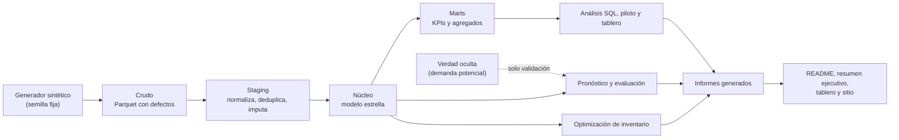
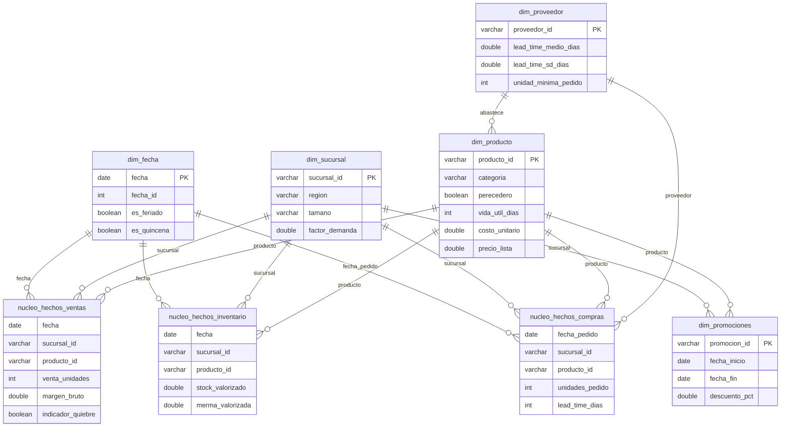

# 03. Capa de datos: modelo, contratos y calidad

El pipeline implementa cuatro capas sobre DuckDB y Parquet, con contratos de datos
verificables y una bitácora de limpieza generada automáticamente en cada ejecución.

- **Filas en la capa núcleo:** 6.402.575
- **Tablas con contrato validado:** 8 (257 chequeos, 0 fallidos)
- **Tasa de filas afectadas por defectos inyectados:** 2,21%

> Todas las cifras de este documento se generan desde `resultados/capa_datos.json` y
> los contratos YAML. No se escriben a mano.

## Capas y linaje

| Capa | Contenido | Persistencia |
|---|---|---|
| Crudo | Extractos con duplicados, nulos, códigos inconsistentes y fechas futuras | `datos/crudo/` |
| Staging | Tablas limpias con reglas documentadas y trazabilidad de defectos | `datos/staging/` |
| Núcleo | Modelo en estrella: hechos de ventas, inventario y compras + dimensiones | `datos/nucleo/` |
| Marts | Agregados mensuales, por SKU, por categoría, promociones y quiebres | `datos/marts/` |

## Modelo entidad-relación

## Diccionario de datos

### `dim_fecha`

Calendario con feriados, quincenas y temporadas.  
**Grano:** una fila por fecha.

| Columna | Tipo | Nulo | Descripción |
|---|---|---|---|
| `fecha` | DATE | No | Fecha calendario del hecho o atributo. |
| `fecha_id` | INTEGER | No | Clave entera de fecha en formato AAAAMMDD. |
| `anio` | INTEGER | No | Año calendario. |
| `mes` | INTEGER | No | Mes calendario (1 a 12). |
| `dia` | INTEGER | No | Día del mes. |
| `trimestre` | INTEGER | No | Trimestre calendario. |
| `dia_semana` | INTEGER | No | Día de la semana (1 = lunes, 7 = domingo). |
| `nombre_dia` | VARCHAR | No | Nombre del día de la semana. |
| `semana_iso` | INTEGER | No | Número de semana ISO. |
| `es_fin_de_semana` | BOOLEAN | No | Indica si la fecha cae en fin de semana. |
| `es_feriado` | BOOLEAN | No | Indica si la fecha es feriado. |
| `nombre_feriado` | VARCHAR | Sí | Nombre del feriado, si aplica. |
| `es_quincena` | BOOLEAN | No | Indica si la fecha corresponde a día de pago quincenal. |
| `temporada` | VARCHAR | No | Temporada comercial de la fecha. |

### `dim_producto`

Maestro de productos (SKU) con atributos, costo y precio de lista.  
**Grano:** una fila por producto.

| Columna | Tipo | Nulo | Descripción |
|---|---|---|---|
| `producto_id` | VARCHAR | No | Identificador de SKU (FK a dim_producto). |
| `nombre_producto` | VARCHAR | No | Nombre comercial del producto. |
| `categoria` | VARCHAR | No | Categoría comercial del producto. |
| `subcategoria` | VARCHAR | No | Subcategoría comercial del producto. |
| `marca` | VARCHAR | No | Marca ficticia del producto. |
| `proveedor_id` | VARCHAR | No | Identificador de proveedor (FK a dim_proveedor). |
| `contenido` | VARCHAR | No | Contenido o tamaño del envase. |
| `perecedero` | BOOLEAN | No | Indica si el producto es perecedero. |
| `vida_util_dias` | INTEGER | No | Vida útil en días desde la recepción. |
| `costo_unitario` | DOUBLE | No | Costo unitario de compra. |
| `precio_lista` | DOUBLE | No | Precio de lista sin promoción. |
| `unidad_medida` | VARCHAR | No | Unidad de medida de venta. |

### `dim_promociones`

Eventos promocionales por SKU y sucursal.  
**Grano:** una fila por promocion, SKU y sucursal.

| Columna | Tipo | Nulo | Descripción |
|---|---|---|---|
| `promocion_id` | VARCHAR | No | Identificador del evento promocional. |
| `producto_id` | VARCHAR | No | Identificador de SKU (FK a dim_producto). |
| `sucursal_id` | VARCHAR | No | Identificador de sucursal (FK a dim_sucursal). |
| `fecha_inicio` | DATE | No | Primer día de vigencia de la promoción. |
| `fecha_fin` | DATE | No | Último día de vigencia de la promoción. |
| `tipo_promocion` | VARCHAR | No | Mecánica promocional aplicada. |
| `descuento_pct` | DOUBLE | No | Descuento porcentual de la promoción. |
| `precio_promocional` | DOUBLE | No | Precio unitario durante la promoción. |
| `uplift_esperado` | DOUBLE | No | Aumento de demanda planificado por la promoción. |

### `dim_proveedor`

Maestro de proveedores con lead time y confiabilidad.  
**Grano:** una fila por proveedor.

| Columna | Tipo | Nulo | Descripción |
|---|---|---|---|
| `proveedor_id` | VARCHAR | No | Identificador de proveedor (FK a dim_proveedor). |
| `nombre_proveedor` | VARCHAR | No | Razón social ficticia del proveedor. |
| `categoria_principal` | VARCHAR | No | Categoría principal que abastece el proveedor. |
| `lead_time_medio_dias` | DOUBLE | No | Lead time medio de entrega en días. |
| `lead_time_sd_dias` | DOUBLE | No | Desviación estándar del lead time. |
| `fiabilidad` | DOUBLE | No | Proporción histórica de entregas completas y a tiempo. |
| `unidad_minima_pedido` | INTEGER | No | Múltiplo mínimo de compra (caja). |
| `condicion_pago` | VARCHAR | No | Condición de pago acordada. |

### `dim_sucursal`

Maestro de sucursales de la cadena.  
**Grano:** una fila por sucursal.

| Columna | Tipo | Nulo | Descripción |
|---|---|---|---|
| `sucursal_id` | VARCHAR | No | Identificador de sucursal (FK a dim_sucursal). |
| `nombre_sucursal` | VARCHAR | No | Nombre comercial de la sucursal. |
| `ciudad` | VARCHAR | No | Ciudad ficticia de la sucursal. |
| `region` | VARCHAR | No | Región comercial (Norte, Centro, Sur, Litoral). |
| `tipo_tienda` | VARCHAR | No | Formato de tienda (hipermercado, supermercado, express). |
| `tamano` | VARCHAR | No | Clasificación de tamaño de la sucursal. |
| `superficie_m2` | INTEGER | No | Superficie de sala de venta en metros cuadrados. |
| `factor_demanda` | DOUBLE | No | Factor de escala de demanda de la sucursal. |
| `fecha_apertura` | DATE | No | Fecha de apertura de la sucursal. |

### `nucleo_hechos_compras`

Pedidos de reposicion por sucursal y SKU con lead time y recepcion.  
**Grano:** una fila por fecha de pedido, sucursal y producto.

| Columna | Tipo | Nulo | Descripción |
|---|---|---|---|
| `fecha_pedido` | DATE | No | Fecha en que se emite el pedido al proveedor. |
| `fecha_pedido_id` | INTEGER | No | Clave entera de la fecha de pedido (AAAAMMDD). |
| `sucursal_id` | VARCHAR | No | Identificador de sucursal (FK a dim_sucursal). |
| `producto_id` | VARCHAR | No | Identificador de SKU (FK a dim_producto). |
| `proveedor_id` | VARCHAR | No | Identificador de proveedor (FK a dim_proveedor). |
| `unidades_pedido` | INTEGER | No | Unidades solicitadas al proveedor (múltiplo de caja). |
| `lead_time_dias` | INTEGER | No | Días entre el pedido y la recepción. |
| `fecha_recepcion` | DATE | No | Fecha estimada o real de recepción del pedido. |
| `estado` | VARCHAR | No | Estado del pedido: recibido o en tránsito al cierre del periodo. |
| `unidades_recibidas` | INTEGER | No | Unidades efectivamente recibidas dentro del periodo. |

### `nucleo_hechos_inventario`

Stock de cierre diario por sucursal y SKU, con merma valorizada.  
**Grano:** una fila por fecha, sucursal y producto.

| Columna | Tipo | Nulo | Descripción |
|---|---|---|---|
| `fecha` | DATE | No | Fecha calendario del hecho o atributo. |
| `fecha_id` | INTEGER | No | Clave entera de fecha en formato AAAAMMDD. |
| `sucursal_id` | VARCHAR | No | Identificador de sucursal (FK a dim_sucursal). |
| `producto_id` | VARCHAR | No | Identificador de SKU (FK a dim_producto). |
| `stock_cierre_unidades` | DOUBLE | No | Stock físico al cierre del día, en unidades. |
| `stock_valorizado` | DOUBLE | No | Valor del stock al costo unitario. |
| `merma_unidades` | DOUBLE | No | Unidades perdidas por vencimiento o deterioro en perecederos. |
| `merma_valorizada` | DOUBLE | No | Valor de la merma al costo unitario. |

### `nucleo_hechos_ventas`

Venta diaria por sucursal y SKU (demanda observada, censurada por quiebre).  
**Grano:** una fila por fecha, sucursal y producto.

| Columna | Tipo | Nulo | Descripción |
|---|---|---|---|
| `fecha` | DATE | No | Fecha calendario del hecho o atributo. |
| `fecha_id` | INTEGER | No | Clave entera de fecha en formato AAAAMMDD. |
| `sucursal_id` | VARCHAR | No | Identificador de sucursal (FK a dim_sucursal). |
| `producto_id` | VARCHAR | No | Identificador de SKU (FK a dim_producto). |
| `venta_unidades` | INTEGER | No | Unidades vendidas y observadas; si hubo quiebre, está censurada. |
| `precio_unitario` | DOUBLE | No | Precio efectivo del día (promocional si aplica). |
| `venta_valorizada` | DOUBLE | No | Venta en unidades monetarias (unidades × precio). |
| `costo_total` | DOUBLE | No | Costo de la mercadería vendida (unidades × costo unitario). |
| `margen_bruto` | DOUBLE | No | Margen bruto del día (venta valorizada − costo). |
| `en_promocion` | BOOLEAN | No | Indica si el SKU estaba en promoción ese día en esa sucursal. |
| `indicador_quiebre` | BOOLEAN | No | Verdadero si la demanda superó el stock disponible (venta censurada). |

## Informe de calidad y bitácora de limpieza

| Tabla | Filas crudas | Filas afectadas | Tasa | Filas limpias |
|---|---:|---:|---:|---:|
| hechos_ventas | 2.899.906 | 77.120 | 2,66% | 2.842.661 |
| hechos_inventario | 2.899.906 | 55.846 | 1,93% | 2.844.060 |
| hechos_compras | 712.907 | 11.286 | 1,58% | 704.438 |
| dim_producto | 403 | 3 | 0,74% | 400 |
| dim_sucursal | 12 | 2 | 16,67% | 12 |
| dim_proveedor | 38 | 2 | 5,26% | 36 |

### Reglas aplicadas

| Tabla | Problema detectado | Regla aplicada | Filas |
|---|---|---|---:|
| hechos_ventas | Duplicados de clave (fecha, sucursal, SKU) | Se conserva una fila por clave, priorizando precio no nulo. | 35.246 |
| hechos_ventas | Códigos de producto inconsistentes | Normalización con UPPER(TRIM()). | 13.052 |
| hechos_ventas | Claves nulas | Se descartan las filas sin fecha, sucursal o producto. | 2.893 |
| hechos_ventas | Venta en unidades nula | Se descarta la fila. | 10.119 |
| hechos_ventas | Precio unitario nulo | Se imputa con precio promocional o precio de lista. | 7.255 |
| hechos_ventas | Cantidades negativas | Se descartan (no se modelan devoluciones en este proyecto). | 7.259 |
| hechos_ventas | Fechas fuera del periodo | Se descartan fechas anteriores a 2024 o posteriores a 2025. | 2.898 |
| hechos_ventas | Claves foráneas inválidas | Se descartan filas con sucursal o producto inexistente. | 0 |
| hechos_inventario | Duplicados de clave (fecha, sucursal, SKU) | Se conserva una fila por clave. | 34.386 |
| hechos_inventario | Códigos de producto inconsistentes | Normalización con UPPER(TRIM()). | 0 |
| hechos_inventario | Stock nulo o negativo | Se descarta la fila (stock negativo es error de sistema). | 21.709 |
| hechos_inventario | Fechas fuera del periodo | Se descartan fechas fuera del periodo. | 0 |
| hechos_inventario | Claves foráneas inválidas | Se descartan filas con sucursal o producto inexistente. | 0 |
| hechos_compras | Duplicados de clave (pedido, sucursal, SKU) | Se conserva una fila por clave. | 7.058 |
| hechos_compras | Lead time nulo | Se imputa con el lead time medio del proveedor. | 2.851 |
| hechos_compras | Unidades no positivas | Se descarta la fila. | 1.424 |
| hechos_compras | Fechas fuera del periodo | Se descartan pedidos fuera del periodo. | 0 |
| hechos_compras | Claves foráneas inválidas | Se descartan filas con sucursal o producto inexistente. | 0 |
| dim_producto | Identificadores duplicados | Se conserva una fila por identificador. | 3 |
| dim_producto | Espacios inconsistentes en textos | Se aplica TRIM() a los campos de texto. | 0 |
| dim_sucursal | Identificadores duplicados | Se conserva una fila por identificador. | 0 |
| dim_sucursal | Espacios inconsistentes en textos | Se aplica TRIM() a los campos de texto. | 2 |
| dim_proveedor | Identificadores duplicados | Se conserva una fila por identificador. | 2 |
| dim_proveedor | Espacios inconsistentes en textos | Se aplica TRIM() a los campos de texto. | 0 |

Las filas afectadas totales consideran la unión de condiciones; un mismo registro
puede presentar más de un defecto. Las filas descartadas corresponden a la
diferencia entre la capa cruda y la capa staging.

## Resultado de los contratos

Se ejecutaron **257** chequeos sobre **8** tablas. Chequeos fallidos: **0**.

| Tabla | Chequeo | Estado | Detalle |
|---|---|---|---|
| dim_fecha | existencia | OK | 14 columnas |
| dim_fecha | tipo fecha | OK | DATE vs DATE |
| dim_fecha | nulabilidad fecha | OK | 0 nulos |
| dim_fecha | tipo fecha_id | OK | INTEGER vs INTEGER |
| dim_fecha | nulabilidad fecha_id | OK | 0 nulos |
| dim_fecha | tipo anio | OK | INTEGER vs INTEGER |
| dim_fecha | nulabilidad anio | OK | 0 nulos |
| dim_fecha | tipo mes | OK | INTEGER vs INTEGER |
| dim_fecha | nulabilidad mes | OK | 0 nulos |
| dim_fecha | tipo dia | OK | INTEGER vs INTEGER |
| dim_fecha | nulabilidad dia | OK | 0 nulos |
| dim_fecha | tipo trimestre | OK | INTEGER vs INTEGER |
| dim_fecha | nulabilidad trimestre | OK | 0 nulos |
| dim_fecha | tipo dia_semana | OK | INTEGER vs INTEGER |
| dim_fecha | nulabilidad dia_semana | OK | 0 nulos |
| dim_fecha | tipo nombre_dia | OK | VARCHAR vs VARCHAR |
| dim_fecha | nulabilidad nombre_dia | OK | 0 nulos |
| dim_fecha | tipo semana_iso | OK | INTEGER vs INTEGER |
| dim_fecha | nulabilidad semana_iso | OK | 0 nulos |
| dim_fecha | tipo es_fin_de_semana | OK | BOOLEAN vs BOOLEAN |
| dim_fecha | nulabilidad es_fin_de_semana | OK | 0 nulos |
| dim_fecha | tipo es_feriado | OK | BOOLEAN vs BOOLEAN |
| dim_fecha | nulabilidad es_feriado | OK | 0 nulos |
| dim_fecha | tipo nombre_feriado | OK | VARCHAR vs VARCHAR |
| dim_fecha | tipo es_quincena | OK | BOOLEAN vs BOOLEAN |
| dim_fecha | nulabilidad es_quincena | OK | 0 nulos |
| dim_fecha | tipo temporada | OK | VARCHAR vs VARCHAR |
| dim_fecha | nulabilidad temporada | OK | 0 nulos |
| dim_fecha | volumen | OK | 731 filas (min 30) |
| dim_fecha | unicidad | OK | 0 claves duplicadas de (fecha) |
| dim_fecha | rango fecha (minimo) | OK | 2024-01-01 vs 2024-01-01 |
| dim_fecha | rango fecha (maximo) | OK | 2025-12-31 vs 2025-12-31 |
| dim_fecha | rango mes (minimo) | OK | 1 vs 1 |
| dim_fecha | rango mes (maximo) | OK | 12 vs 12 |
| dim_fecha | rango dia_semana (minimo) | OK | 1 vs 1 |
| dim_fecha | rango dia_semana (maximo) | OK | 7 vs 7 |
| dim_producto | existencia | OK | 12 columnas |
| dim_producto | tipo producto_id | OK | VARCHAR vs VARCHAR |
| dim_producto | nulabilidad producto_id | OK | 0 nulos |
| dim_producto | tipo nombre_producto | OK | VARCHAR vs VARCHAR |
| dim_producto | nulabilidad nombre_producto | OK | 0 nulos |
| dim_producto | tipo categoria | OK | VARCHAR vs VARCHAR |
| dim_producto | nulabilidad categoria | OK | 0 nulos |
| dim_producto | tipo subcategoria | OK | VARCHAR vs VARCHAR |
| dim_producto | nulabilidad subcategoria | OK | 0 nulos |
| dim_producto | tipo marca | OK | VARCHAR vs VARCHAR |
| dim_producto | nulabilidad marca | OK | 0 nulos |
| dim_producto | tipo proveedor_id | OK | VARCHAR vs VARCHAR |
| dim_producto | nulabilidad proveedor_id | OK | 0 nulos |
| dim_producto | tipo contenido | OK | VARCHAR vs VARCHAR |
| dim_producto | nulabilidad contenido | OK | 0 nulos |
| dim_producto | tipo perecedero | OK | BOOLEAN vs BOOLEAN |
| dim_producto | nulabilidad perecedero | OK | 0 nulos |
| dim_producto | tipo vida_util_dias | OK | INTEGER vs INTEGER |
| dim_producto | nulabilidad vida_util_dias | OK | 0 nulos |
| dim_producto | tipo costo_unitario | OK | DOUBLE vs DOUBLE |
| dim_producto | nulabilidad costo_unitario | OK | 0 nulos |
| dim_producto | tipo precio_lista | OK | DOUBLE vs DOUBLE |
| dim_producto | nulabilidad precio_lista | OK | 0 nulos |
| dim_producto | tipo unidad_medida | OK | VARCHAR vs VARCHAR |
| dim_producto | nulabilidad unidad_medida | OK | 0 nulos |
| dim_producto | volumen | OK | 400 filas (min 10) |
| dim_producto | unicidad | OK | 0 claves duplicadas de (producto_id) |
| dim_producto | rango vida_util_dias (minimo) | OK | 2 vs 1 |
| dim_producto | rango vida_util_dias (maximo) | OK | 899 vs 1000 |
| dim_producto | rango costo_unitario (minimo) | OK | 0.33 vs 0.01 |
| dim_producto | rango costo_unitario (maximo) | OK | 13.77 vs 1000 |
| dim_producto | rango precio_lista (minimo) | OK | 0.5 vs 0.01 |
| dim_producto | rango precio_lista (maximo) | OK | 20.0 vs 2000 |
| dim_producto | fk proveedor_id -> dim_proveedor | OK | 0 huerfanas |
| dim_promociones | existencia | OK | 9 columnas |
| dim_promociones | tipo promocion_id | OK | VARCHAR vs VARCHAR |
| dim_promociones | nulabilidad promocion_id | OK | 0 nulos |
| dim_promociones | tipo producto_id | OK | VARCHAR vs VARCHAR |
| dim_promociones | nulabilidad producto_id | OK | 0 nulos |
| dim_promociones | tipo sucursal_id | OK | VARCHAR vs VARCHAR |
| dim_promociones | nulabilidad sucursal_id | OK | 0 nulos |
| dim_promociones | tipo fecha_inicio | OK | DATE vs DATE |
| dim_promociones | nulabilidad fecha_inicio | OK | 0 nulos |
| dim_promociones | tipo fecha_fin | OK | DATE vs DATE |
| dim_promociones | nulabilidad fecha_fin | OK | 0 nulos |
| dim_promociones | tipo tipo_promocion | OK | VARCHAR vs VARCHAR |
| dim_promociones | nulabilidad tipo_promocion | OK | 0 nulos |
| dim_promociones | tipo descuento_pct | OK | DOUBLE vs DOUBLE |
| dim_promociones | nulabilidad descuento_pct | OK | 0 nulos |
| dim_promociones | tipo precio_promocional | OK | DOUBLE vs DOUBLE |
| dim_promociones | nulabilidad precio_promocional | OK | 0 nulos |
| dim_promociones | tipo uplift_esperado | OK | DOUBLE vs DOUBLE |
| dim_promociones | nulabilidad uplift_esperado | OK | 0 nulos |
| dim_promociones | volumen | OK | 10237 filas (min 10) |
| dim_promociones | unicidad | OK | 0 claves duplicadas de (promocion_id, producto_id, sucursal_id) |
| dim_promociones | rango fecha_inicio (minimo) | OK | 2024-01-11 vs 2024-01-01 |
| dim_promociones | rango fecha_inicio (maximo) | OK | 2025-12-18 vs 2025-12-30 |
| dim_promociones | rango descuento_pct (minimo) | OK | 0.1 vs 0 |
| dim_promociones | rango descuento_pct (maximo) | OK | 0.5 vs 0.8 |
| dim_promociones | rango precio_promocional (minimo) | OK | 0.3 vs 0.01 |
| dim_promociones | rango precio_promocional (maximo) | OK | 16.9 vs 2000 |
| dim_promociones | fk producto_id -> dim_producto | OK | 0 huerfanas |
| dim_promociones | fk sucursal_id -> dim_sucursal | OK | 0 huerfanas |
| dim_proveedor | existencia | OK | 8 columnas |
| dim_proveedor | tipo proveedor_id | OK | VARCHAR vs VARCHAR |
| dim_proveedor | nulabilidad proveedor_id | OK | 0 nulos |
| dim_proveedor | tipo nombre_proveedor | OK | VARCHAR vs VARCHAR |
| dim_proveedor | nulabilidad nombre_proveedor | OK | 0 nulos |
| dim_proveedor | tipo categoria_principal | OK | VARCHAR vs VARCHAR |
| dim_proveedor | nulabilidad categoria_principal | OK | 0 nulos |
| dim_proveedor | tipo lead_time_medio_dias | OK | DOUBLE vs DOUBLE |
| dim_proveedor | nulabilidad lead_time_medio_dias | OK | 0 nulos |
| dim_proveedor | tipo lead_time_sd_dias | OK | DOUBLE vs DOUBLE |
| dim_proveedor | nulabilidad lead_time_sd_dias | OK | 0 nulos |
| dim_proveedor | tipo fiabilidad | OK | DOUBLE vs DOUBLE |
| dim_proveedor | nulabilidad fiabilidad | OK | 0 nulos |
| dim_proveedor | tipo unidad_minima_pedido | OK | INTEGER vs INTEGER |
| dim_proveedor | nulabilidad unidad_minima_pedido | OK | 0 nulos |
| dim_proveedor | tipo condicion_pago | OK | VARCHAR vs VARCHAR |
| dim_proveedor | nulabilidad condicion_pago | OK | 0 nulos |
| dim_proveedor | volumen | OK | 36 filas (min 2) |
| dim_proveedor | unicidad | OK | 0 claves duplicadas de (proveedor_id) |
| dim_proveedor | rango lead_time_medio_dias (minimo) | OK | 1.2 vs 0.5 |
| dim_proveedor | rango lead_time_medio_dias (maximo) | OK | 17.2 vs 40 |
| dim_proveedor | rango lead_time_sd_dias (minimo) | OK | 0.3 vs 0 |
| dim_proveedor | rango lead_time_sd_dias (maximo) | OK | 3.1 vs 10 |
| dim_proveedor | rango fiabilidad (minimo) | OK | 0.85 vs 0 |
| dim_proveedor | rango fiabilidad (maximo) | OK | 0.99 vs 1 |
| dim_proveedor | rango unidad_minima_pedido (minimo) | OK | 6 vs 1 |
| dim_proveedor | rango unidad_minima_pedido (maximo) | OK | 24 vs 100 |
| dim_sucursal | existencia | OK | 9 columnas |
| dim_sucursal | tipo sucursal_id | OK | VARCHAR vs VARCHAR |
| dim_sucursal | nulabilidad sucursal_id | OK | 0 nulos |
| dim_sucursal | tipo nombre_sucursal | OK | VARCHAR vs VARCHAR |
| dim_sucursal | nulabilidad nombre_sucursal | OK | 0 nulos |
| dim_sucursal | tipo ciudad | OK | VARCHAR vs VARCHAR |
| dim_sucursal | nulabilidad ciudad | OK | 0 nulos |
| dim_sucursal | tipo region | OK | VARCHAR vs VARCHAR |
| dim_sucursal | nulabilidad region | OK | 0 nulos |
| dim_sucursal | tipo tipo_tienda | OK | VARCHAR vs VARCHAR |
| dim_sucursal | nulabilidad tipo_tienda | OK | 0 nulos |
| dim_sucursal | tipo tamano | OK | VARCHAR vs VARCHAR |
| dim_sucursal | nulabilidad tamano | OK | 0 nulos |
| dim_sucursal | tipo superficie_m2 | OK | INTEGER vs INTEGER |
| dim_sucursal | nulabilidad superficie_m2 | OK | 0 nulos |
| dim_sucursal | tipo factor_demanda | OK | DOUBLE vs DOUBLE |
| dim_sucursal | nulabilidad factor_demanda | OK | 0 nulos |
| dim_sucursal | tipo fecha_apertura | OK | DATE vs DATE |
| dim_sucursal | nulabilidad fecha_apertura | OK | 0 nulos |
| dim_sucursal | volumen | OK | 12 filas (min 2) |
| dim_sucursal | unicidad | OK | 0 claves duplicadas de (sucursal_id) |
| dim_sucursal | rango superficie_m2 (minimo) | OK | 975 vs 100 |
| dim_sucursal | rango superficie_m2 (maximo) | OK | 2184 vs 5000 |
| dim_sucursal | rango factor_demanda (minimo) | OK | 0.641 vs 0.3 |
| dim_sucursal | rango factor_demanda (maximo) | OK | 1.516 vs 2.0 |
| nucleo_hechos_compras | existencia | OK | 11 columnas |
| nucleo_hechos_compras | tipo fecha_pedido | OK | DATE vs DATE |
| nucleo_hechos_compras | nulabilidad fecha_pedido | OK | 0 nulos |
| nucleo_hechos_compras | tipo fecha_pedido_id | OK | INTEGER vs INTEGER |
| nucleo_hechos_compras | nulabilidad fecha_pedido_id | OK | 0 nulos |
| nucleo_hechos_compras | tipo sucursal_id | OK | VARCHAR vs VARCHAR |
| nucleo_hechos_compras | nulabilidad sucursal_id | OK | 0 nulos |
| nucleo_hechos_compras | tipo producto_id | OK | VARCHAR vs VARCHAR |
| nucleo_hechos_compras | nulabilidad producto_id | OK | 0 nulos |
| nucleo_hechos_compras | tipo proveedor_id | OK | VARCHAR vs VARCHAR |
| nucleo_hechos_compras | nulabilidad proveedor_id | OK | 0 nulos |
| nucleo_hechos_compras | tipo unidades_pedido | OK | INTEGER vs INTEGER |
| nucleo_hechos_compras | nulabilidad unidades_pedido | OK | 0 nulos |
| nucleo_hechos_compras | tipo lead_time_dias | OK | INTEGER vs INTEGER |
| nucleo_hechos_compras | nulabilidad lead_time_dias | OK | 0 nulos |
| nucleo_hechos_compras | tipo fecha_recepcion | OK | DATE vs DATE |
| nucleo_hechos_compras | nulabilidad fecha_recepcion | OK | 0 nulos |
| nucleo_hechos_compras | tipo estado | OK | VARCHAR vs VARCHAR |
| nucleo_hechos_compras | nulabilidad estado | OK | 0 nulos |
| nucleo_hechos_compras | tipo unidades_recibidas | OK | INTEGER vs INTEGER |
| nucleo_hechos_compras | nulabilidad unidades_recibidas | OK | 0 nulos |
| nucleo_hechos_compras | volumen | OK | 704438 filas (min 100) |
| nucleo_hechos_compras | unicidad | OK | 0 claves duplicadas de (fecha_pedido, sucursal_id, producto_id) |
| nucleo_hechos_compras | rango fecha_pedido (minimo) | OK | 2024-01-01 vs 2024-01-01 |
| nucleo_hechos_compras | rango fecha_pedido (maximo) | OK | 2025-12-30 vs 2025-12-31 |
| nucleo_hechos_compras | rango unidades_pedido (minimo) | OK | 4 vs 1 |
| nucleo_hechos_compras | rango unidades_pedido (maximo) | OK | 4692 vs 50000 |
| nucleo_hechos_compras | rango lead_time_dias (minimo) | OK | 1 vs 1 |
| nucleo_hechos_compras | rango lead_time_dias (maximo) | OK | 28 vs 40 |
| nucleo_hechos_compras | rango unidades_recibidas (minimo) | OK | 0 vs 0 |
| nucleo_hechos_compras | rango unidades_recibidas (maximo) | OK | 4692 vs 50000 |
| nucleo_hechos_compras | fk sucursal_id -> dim_sucursal | OK | 0 huerfanas |
| nucleo_hechos_compras | fk producto_id -> dim_producto | OK | 0 huerfanas |
| nucleo_hechos_compras | fk proveedor_id -> dim_proveedor | OK | 0 huerfanas |
| nucleo_hechos_inventario | existencia | OK | 8 columnas |
| nucleo_hechos_inventario | tipo fecha | OK | DATE vs DATE |
| nucleo_hechos_inventario | nulabilidad fecha | OK | 0 nulos |
| nucleo_hechos_inventario | tipo fecha_id | OK | INTEGER vs INTEGER |
| nucleo_hechos_inventario | nulabilidad fecha_id | OK | 0 nulos |
| nucleo_hechos_inventario | tipo sucursal_id | OK | VARCHAR vs VARCHAR |
| nucleo_hechos_inventario | nulabilidad sucursal_id | OK | 0 nulos |
| nucleo_hechos_inventario | tipo producto_id | OK | VARCHAR vs VARCHAR |
| nucleo_hechos_inventario | nulabilidad producto_id | OK | 0 nulos |
| nucleo_hechos_inventario | tipo stock_cierre_unidades | OK | DOUBLE vs DOUBLE |
| nucleo_hechos_inventario | nulabilidad stock_cierre_unidades | OK | 0 nulos |
| nucleo_hechos_inventario | tipo stock_valorizado | OK | DOUBLE vs DOUBLE |
| nucleo_hechos_inventario | nulabilidad stock_valorizado | OK | 0 nulos |
| nucleo_hechos_inventario | tipo merma_unidades | OK | DOUBLE vs DOUBLE |
| nucleo_hechos_inventario | nulabilidad merma_unidades | OK | 0 nulos |
| nucleo_hechos_inventario | tipo merma_valorizada | OK | DOUBLE vs DOUBLE |
| nucleo_hechos_inventario | nulabilidad merma_valorizada | OK | 0 nulos |
| nucleo_hechos_inventario | volumen | OK | 2844060 filas (min 1000) |
| nucleo_hechos_inventario | unicidad | OK | 0 claves duplicadas de (fecha, sucursal_id, producto_id) |
| nucleo_hechos_inventario | rango fecha (minimo) | OK | 2024-01-01 vs 2024-01-01 |
| nucleo_hechos_inventario | rango fecha (maximo) | OK | 2025-12-31 vs 2025-12-31 |
| nucleo_hechos_inventario | rango stock_cierre_unidades (minimo) | OK | 0.0 vs 0 |
| nucleo_hechos_inventario | rango stock_cierre_unidades (maximo) | OK | 5094.0 vs 100000 |
| nucleo_hechos_inventario | rango stock_valorizado (minimo) | OK | 0.0 vs 0 |
| nucleo_hechos_inventario | rango stock_valorizado (maximo) | OK | 40140.72 vs 1000000 |
| nucleo_hechos_inventario | rango merma_unidades (minimo) | OK | 0.0 vs 0 |
| nucleo_hechos_inventario | rango merma_unidades (maximo) | OK | 17.29 vs 10000 |
| nucleo_hechos_inventario | rango merma_valorizada (minimo) | OK | 0.0 vs 0 |
| nucleo_hechos_inventario | rango merma_valorizada (maximo) | OK | 113.7 vs 1000000 |
| nucleo_hechos_inventario | fk sucursal_id -> dim_sucursal | OK | 0 huerfanas |
| nucleo_hechos_inventario | fk producto_id -> dim_producto | OK | 0 huerfanas |
| nucleo_hechos_inventario | fk fecha -> dim_fecha | OK | 0 huerfanas |
| nucleo_hechos_ventas | existencia | OK | 11 columnas |
| nucleo_hechos_ventas | tipo fecha | OK | DATE vs DATE |
| nucleo_hechos_ventas | nulabilidad fecha | OK | 0 nulos |
| nucleo_hechos_ventas | tipo fecha_id | OK | INTEGER vs INTEGER |
| nucleo_hechos_ventas | nulabilidad fecha_id | OK | 0 nulos |
| nucleo_hechos_ventas | tipo sucursal_id | OK | VARCHAR vs VARCHAR |
| nucleo_hechos_ventas | nulabilidad sucursal_id | OK | 0 nulos |
| nucleo_hechos_ventas | tipo producto_id | OK | VARCHAR vs VARCHAR |
| nucleo_hechos_ventas | nulabilidad producto_id | OK | 0 nulos |
| nucleo_hechos_ventas | tipo venta_unidades | OK | INTEGER vs INTEGER |
| nucleo_hechos_ventas | nulabilidad venta_unidades | OK | 0 nulos |
| nucleo_hechos_ventas | tipo precio_unitario | OK | DOUBLE vs DOUBLE |
| nucleo_hechos_ventas | nulabilidad precio_unitario | OK | 0 nulos |
| nucleo_hechos_ventas | tipo venta_valorizada | OK | DOUBLE vs DOUBLE |
| nucleo_hechos_ventas | nulabilidad venta_valorizada | OK | 0 nulos |
| nucleo_hechos_ventas | tipo costo_total | OK | DOUBLE vs DOUBLE |
| nucleo_hechos_ventas | nulabilidad costo_total | OK | 0 nulos |
| nucleo_hechos_ventas | tipo margen_bruto | OK | DOUBLE vs DOUBLE |
| nucleo_hechos_ventas | nulabilidad margen_bruto | OK | 0 nulos |
| nucleo_hechos_ventas | tipo en_promocion | OK | BOOLEAN vs BOOLEAN |
| nucleo_hechos_ventas | nulabilidad en_promocion | OK | 0 nulos |
| nucleo_hechos_ventas | tipo indicador_quiebre | OK | BOOLEAN vs BOOLEAN |
| nucleo_hechos_ventas | nulabilidad indicador_quiebre | OK | 0 nulos |
| nucleo_hechos_ventas | volumen | OK | 2842661 filas (min 1000) |
| nucleo_hechos_ventas | unicidad | OK | 0 claves duplicadas de (fecha, sucursal_id, producto_id) |
| nucleo_hechos_ventas | rango fecha (minimo) | OK | 2024-01-01 vs 2024-01-01 |
| nucleo_hechos_ventas | rango fecha (maximo) | OK | 2025-12-31 vs 2025-12-31 |
| nucleo_hechos_ventas | rango venta_unidades (minimo) | OK | 0 vs 0 |
| nucleo_hechos_ventas | rango venta_unidades (maximo) | OK | 799 vs 5000 |
| nucleo_hechos_ventas | rango precio_unitario (minimo) | OK | 0.3 vs 0.01 |
| nucleo_hechos_ventas | rango precio_unitario (maximo) | OK | 20.0 vs 1000 |
| nucleo_hechos_ventas | rango venta_valorizada (minimo) | OK | 0.0 vs 0 |
| nucleo_hechos_ventas | rango venta_valorizada (maximo) | OK | 7990.0 vs 5000000 |
| nucleo_hechos_ventas | rango costo_total (minimo) | OK | 0.0 vs 0 |
| nucleo_hechos_ventas | rango costo_total (maximo) | OK | 6296.12 vs 5000000 |
| nucleo_hechos_ventas | rango margen_bruto (minimo) | OK | -1109.68 vs -2000000 |
| nucleo_hechos_ventas | rango margen_bruto (maximo) | OK | 1803.2 vs 5000000 |
| nucleo_hechos_ventas | fk sucursal_id -> dim_sucursal | OK | 0 huerfanas |
| nucleo_hechos_ventas | fk producto_id -> dim_producto | OK | 0 huerfanas |
| nucleo_hechos_ventas | fk fecha -> dim_fecha | OK | 0 huerfanas |
