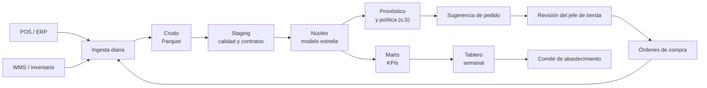

# 09. Plan de implementación

## Principios

1. **Despliegue por olas:** ninguna sucursal cambia de política sin haber pasado por el
   piloto y sin cumplir los criterios de la compuerta de decisión.
2. **Un solo juego de parámetros:** la política se configura en `config/parametros.yaml`;
   no se admiten planillas paralelas ni ajustes manuales por tienda.
3. **Trazabilidad de punta a punta:** cada KPI del tablero debe poder reconstruirse desde
   una tabla de la capa núcleo y un módulo del repositorio.
4. **Reversión sencilla:** la política anterior queda disponible como configuración de
   respaldo y puede reactivarse por sucursal en el siguiente ciclo de reposición.

## Arquitectura objetivo

- **Frecuencia:** ingesta diaria; pronóstico y sugerido de pedido semanal por tienda;
  recálculo de parámetros de seguridad mensual.
- **Tecnología:** DuckDB y Parquet para el análisis; Python para los modelos; el tablero
  consume los agregados de los marts. No se requiere un data warehouse adicional para
  el piloto.
- **Seguridad:** datos sintéticos en este portafolio; en producción, accesos por rol,
  credenciales fuera del repositorio y datos personales fuera del alcance.

## Olas y cronograma

| Ola | Sucursales | Alcance | Compuerta de salida |
|---|---|---|---|
| Preparación | 0 | Datos, contratos, tablero, capacitación | Calidad < 3% de filas afectadas; usuarios entrenados |
| Piloto | 4 tratamiento / 8 control | 12 semanas pre + 12 semanas post | Efecto DiD positivo y significativo; sin efectos negativos |
| Ola 1 | 4 | Reposición semanal con la nueva política | Fill rate y capital dentro de tolerancia |
| Ola 2 | 4 | Cierre del despliegue | Beneficio anual en línea con el caso de negocio |

La asignación del piloto se estratifica por tamaño y desempeño histórico. Las olas
siguientes priorizan surtido y complejidad operativa, no conveniencia.

## Roles y responsabilidades

| Actividad | Gerencia de Cadena | Abastecimiento | Datos / BI | TI | Finanzas | Jefes de tienda |
|---|---|---|---|---|---|---|
| Aprobar política y olas | A | R | C | I | C | I |
| Mantener datos maestros | C | A | R | C | I | I |
| Ejecutar pipeline y tablero | I | C | A/R | C | I | I |
| Revisar sugerido de pedido | I | A | C | I | I | R |
| Validar ahorro y capital | C | C | R | I | A | I |
| Capacitación y cambio | A | R | C | C | I | R |

A = responsable final; R = ejecuta; C = consulta; I = informado.

## Operación y monitoreo

- **Diario:** control de ingesta, duplicados, nulos y fechas futuras; semáforo de calidad.
- **Semanal:** tablero de fill rate, tasa de quiebre, capital, merma y pedidos; revisión
  de excepciones (quiebres A, sobre-stock C, pedidos rechazados).
- **Mensual:** recálculo de niveles de servicio y lead times; revisión de desvíos contra
  el caso de negocio.
- **Trimestral:** reentrenamiento del pronóstico y revisión de la matriz ABC-XYZ.

### Alertas propuestas

| Señal | Umbral | Acción |
|---|---|---|
| Fill rate semanal | Cae más de 2 pp vs. las 4 semanas previas | Revisar quiebres A y lead times |
| Capital | Sube más de 5% vs. presupuesto | Auditar sobre-stock C y pedidos abiertos |
| Merma | Sube más de 1 pp vs. plan | Revisar cobertura de perecederos |
| Calidad de datos | Más de 3% de filas afectadas | Bloquear publicación del tablero |
| Pedido sugerido | Más de 20% de excepciones | Revisar parámetros y capacitación |

## Riesgos y mitigaciones

| Riesgo | Impacto | Mitigación |
|---|---|---|
| Lead times distintos a los modelados | Quiebres o sobre-stock | Recalcular por proveedor; colchón por variabilidad |
| Resistencia al cambio | Pedidos manuales fuera de política | Capacitación, piloto con campeones y métricas visibles |
| Calidad de datos maestros | Pronóstico y pedidos erróneos | Contratos, validaciones y dueño de dato |
| Sobreajuste al histórico | Pérdida de desempeño | Backtesting rolling-origin y monitoreo mensual |
| Doble conteo de beneficios | Caso de negocio inflado | Una sola fuente: `resultados/negocio.json` |
| Dependencia de una persona | Riesgo operativo | Runbook, revisión cruzada y CI |

## Criterios de aceptación

- Fill rate: mejora de al menos 1 pp en el piloto, sin deterioro del capital.
- Capital: variación dentro de ±2% respecto de la línea base.
- Merma: reducción de al menos 20% en perecederos.
- Costo total: reducción positiva y consistente en las réplicas.
- Operación: menos de 3% de filas afectadas por calidad y 100% de contratos válidos.
- Adopción: al menos 80% de los pedidos sugeridos revisados y aceptados en la ola.

## Entrega y soporte

El traspaso incluye este repositorio, el diccionario de datos, los ADR, el tablero, el
caso de negocio en Excel con fórmulas y el runbook de operación. El equipo de Datos/BI
queda como dueño técnico; Abastecimiento, como dueño funcional de la política.
